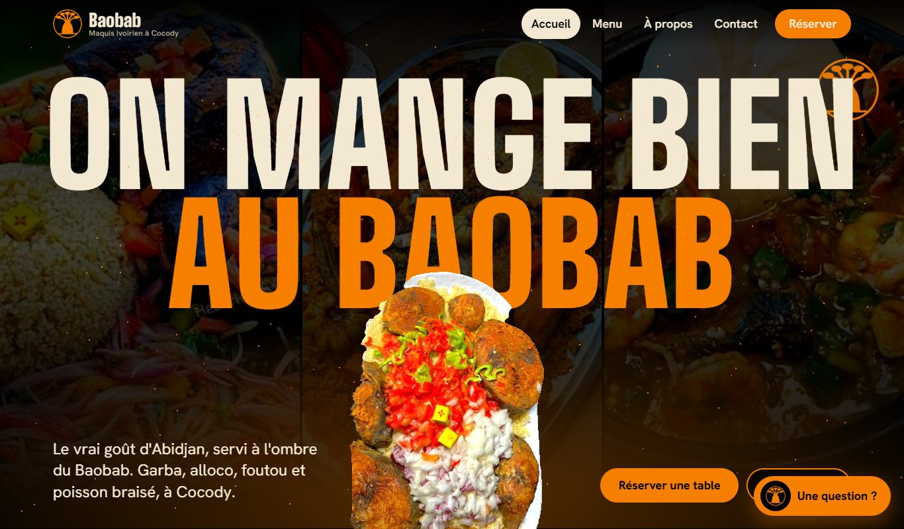
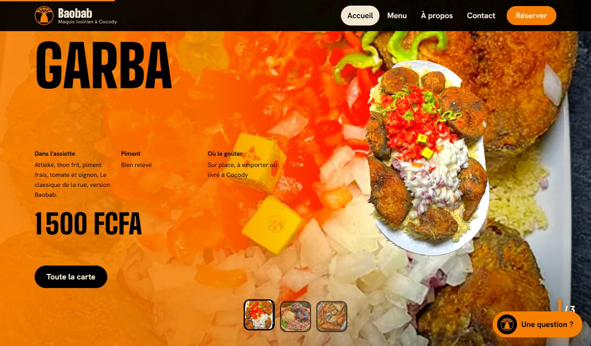
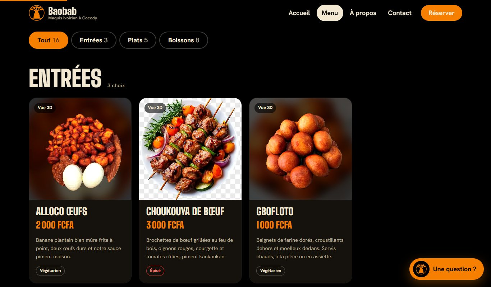
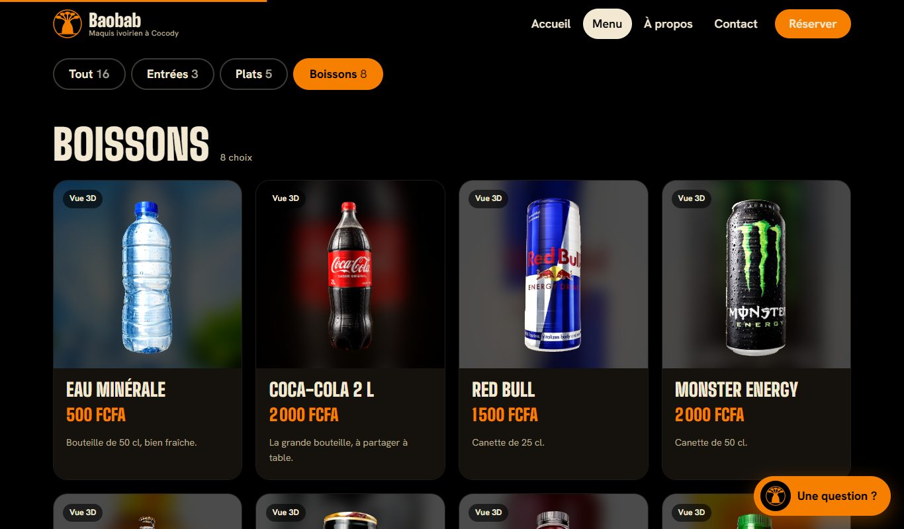
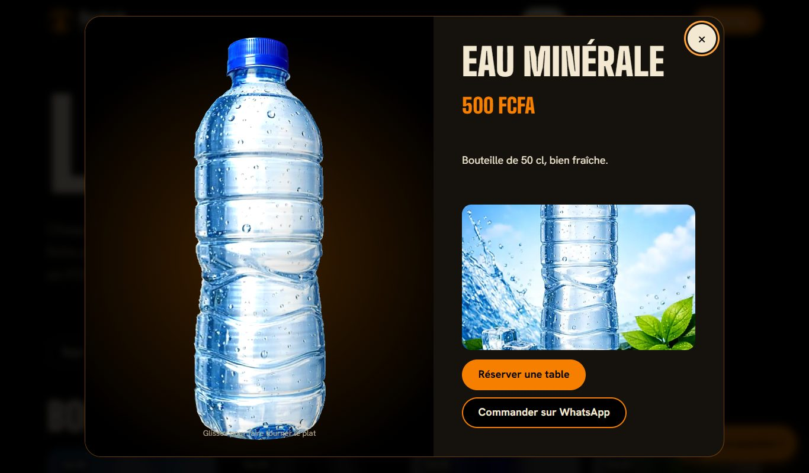
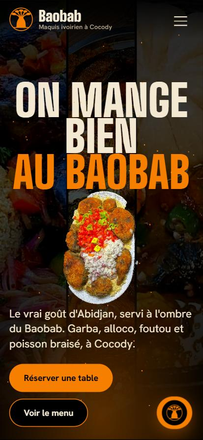
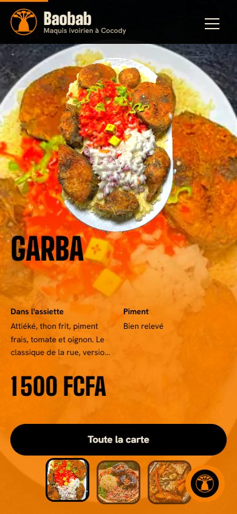
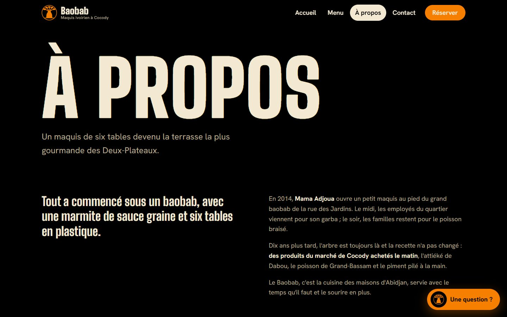
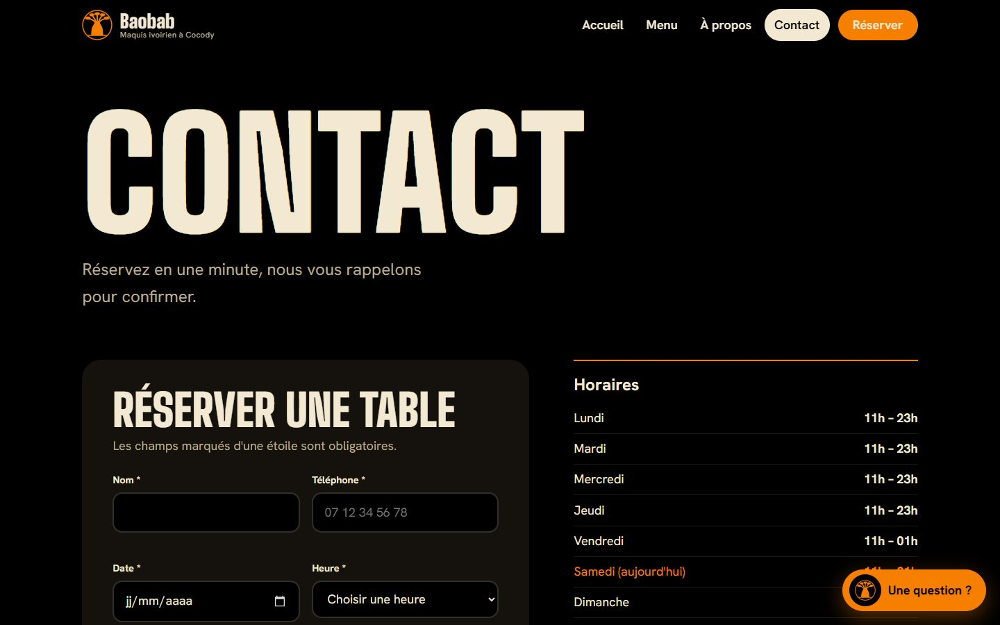

# Le Baobab — site vitrine et chatbot

Site de 4 pages pour **Le Baobab**, restaurant ivoirien à Cocody (Abidjan) : menu en 3D, réservation en ligne et assistant qui répond tout seul aux questions des clients.

HTML, CSS et JavaScript sans framework. La 3D utilise [Three.js](https://threejs.org) (chargé depuis un CDN, aucune installation).



## Les pages

| Page | Contenu |
|---|---|
| `index.html` — Accueil | Titre géant, garba en 3D qui suit la souris et le défilement, plats phares (scroll ou vignettes), avis clients, FAQ, bouton Réserver |
| `menu.html` — Menu | Entrées, plats, boissons en 3D avec prix en FCFA, filtres par catégorie, fiche détaillée avec plat à faire tourner au doigt |
| `a-propos.html` — À propos | Histoire du restaurant, dates clés, équipe, galerie de 6 photos |
| `contact.html` — Contact | Formulaire de réservation validé, horaires (jour courant en surbrillance), Google Maps, boutons WhatsApp |

Sur toutes les pages : menu hamburger sur téléphone et chatbot flottant en bas à droite.

| Plats phares | Menu, entrées | Menu, boissons |
|---|---|---|
|  |  |  |

| Fiche 3D | Téléphone, accueil | Téléphone, plats phares |
|---|---|---|
|  |  |  |

| À propos | Contact |
|---|---|
|  |  |

## Lancer le site en local

Le menu est lu depuis un fichier JSON : il faut un petit serveur (ouvrir le fichier `index.html` directement ne marche pas).

```powershell
python -m http.server 5173
```

Puis ouvrir http://localhost:5173.

## Modifier le menu (sans toucher au code)

Tout est dans [`data/menu.json`](data/menu.json). Chaque article ressemble à ceci :

```json
{
  "id": "garba",
  "nom": "Garba",
  "categorie": "plats",
  "prix": 1500,
  "description": "Attiéké, thon frit, piment frais, tomate et oignon.",
  "image": "assets/img/garba.webp",
  "modele": "garba",
  "phare": true,
  "tags": ["Épicé", "Best-seller"]
}
```

- **prix** : un nombre, en FCFA (affiché automatiquement « 1 500 FCFA »).
- **categorie** : `entrees`, `plats` ou `boissons`.
- **phare** : `true` pour l'afficher dans les plats phares de l'accueil (4 maximum).
- **modele** : le modèle 3D à utiliser. Modèles disponibles :
  `garba`, `attieke-poisson`, `riz-gras`, `alloco`, `foutou-graine`, `foutou-gombo`, `choukouya`, `gbofloto`,
  `eau`, `coca`, `redbull`, `monster`, `desperados`, `vody`, `bissap`, `orange`.
  Pour un nouveau plat, mettez un nom qui n'existe pas dans la liste : le site pose alors **sa photo sur une assiette 3D**.
- **tags** : étiquettes libres. `Épicé` s'affiche en rouge, `Best-seller` en orange.

Le chatbot lit aussi ce fichier : un prix modifié ici est donné juste par l'assistant.

## Brancher la réservation par e-mail (Formspree)

1. Créer un compte gratuit sur [formspree.io](https://formspree.io) avec l'adresse du restaurant et créer un formulaire.
2. Copier l'identifiant (la fin de l'URL, par exemple `xyzabcd` dans `https://formspree.io/f/xyzabcd`).
3. Le coller dans [`js/config.js`](js/config.js) : `formspreeId: 'xyzabcd'`.

Tant que l'identifiant est vide, le bouton « Envoyer la réservation » ouvre WhatsApp avec la demande déjà rédigée : aucune réservation n'est perdue.

Le même fichier contient le numéro WhatsApp (fictif pour l'instant), le téléphone, l'adresse, les horaires et les frais de livraison.

## Le chatbot

Sans API payante : il détecte des mots-clés (accents et majuscules ignorés). Il répond à :

1. salutations
2. horaires, et si le restaurant est ouvert en ce moment
3. adresse et plan
4. menu et plats phares
5. fourchette de prix
6. prix d'un plat précis (« prix du garba », « combien le bissap »)
7. livraison (zones, frais, délai)
8. réservation, avec extraction du nombre de personnes, du jour et de l'heure (« table pour 4 samedi à 20h »)
9. moyens de paiement (Wave, Orange Money, MTN, Moov, carte, espèces)
10. boissons
11. options végétariennes et allergies
12. groupes et anniversaires
13. parking
14. Wi-Fi
15. piment
16. enfants
17. téléphone, WhatsApp et e-mail
18. remerciements

Le bouton **Réserver une table** du chatbot ouvre la page Contact avec le formulaire pré-rempli (personnes, date, heure). Il ne reste que le nom et le téléphone. Les réponses sont dans [`js/main.js`](js/main.js), tableau `INTENTS` : on peut y ajouter une question sans rien casser. Une version reliée à un modèle d'IA pourra remplacer la fonction `answer()`.

## La 3D réaliste (photo en relief)

Les 16 plats et boissons sont rendus en 3D à partir de leurs vraies photos :

1. **Amélioration** de chaque photo (contraste, couleurs, netteté, agrandissement des petites images).
2. **Détourage** par IA (BiRefNet, licence MIT). Pour les boissons, la silhouette est ensuite rendue pleine et les éléments autour (glaçons, éclaboussures) sont retirés.
3. **Carte de profondeur** par IA (Depth Anything V2), lissée pour éviter les déchirures.
4. Dans le navigateur, [`js/splat.js`](js/splat.js) :
   - fait **apparaître** le plat à partir de « gaussian splats » (une tache par pixel qui vient se placer) ;
   - le remplace ensuite par une **surface continue en relief**, texturée par la photo, avec ombrage, reflets et liseré lumineux qui se déplacent quand l'objet pivote. Les boissons ont un profil cylindrique et des reflets plus brillants.

La vue vient d'une seule photo : la rotation est donc limitée (environ ±50°) pour ne jamais montrer l'arrière vide. Un vrai scan à 360° demande une vidéo du plat filmé tout autour (Luma AI, Polycam, Postshot) : le fichier obtenu pourra remplacer ces textures plus tard.

Les vraies photos servent aussi d'**arrière-plan** : mosaïque sombre dans le héros, photo du plat en cours dans les plats phares (l'orange ne couvre plus que la colonne de texte), photo floutée derrière chaque carte et dans la fiche.

## Animations au défilement (GSAP ScrollTrigger)

[`js/motion.js`](js/motion.js), sur les 4 pages, avec [GSAP 3.12](https://gsap.com) et ScrollTrigger :

- titres qui montent lettre par lettre (le texte entier reste lu par les lecteurs d'écran) ;
- héros qui s'ouvre au défilement : les deux lignes du titre s'écartent, les photos de fond zooment ;
- plats phares aimantés : le défilement se cale sur chaque plat, le nom, les détails et le compteur (1 / 3) s'animent à chaque changement ;
- bandeau « Garba, Alloco, Attiéké… » qui glisse avec le défilement ;
- cartes du menu, avis, FAQ, équipe et galerie en cascade, parallaxe dans la galerie, frise des dates qui se trace ;
- barre de progression orange en haut de page.

Tout le contenu reste visible sans JavaScript, et `prefers-reduced-motion` coupe les animations.

**Ajouter un plat avec sa photo en 3D** : placer la photo dans le dossier source, puis lancer les deux scripts de [`tools/ia/`](tools/ia/) (Node.js et Python) :

```powershell
npm i @huggingface/transformers@3.7.2 sharp
node tools/ia/run.mjs <dossier-photos> <dossier-ia>
python tools/ia/prep.py <dossier-photos> <dossier-ia> .
```

puis indiquer `"splat": "assets/splat/<id>"` dans `data/menu.json`. Sans `splat`, le plat utilise un modèle 3D dessiné (`modele`).

- **Page Menu** : un seul contexte WebGL dessine toutes les cartes (technique du « scissor »), seules les cartes visibles sont calculées, un modèle neuf par image pour ne jamais figer la page.
- **Performance** : la page s'affiche d'abord avec la photo détourée du garba (accueil) ou les photos (menu). La 3D démarre au premier mouvement de souris, toucher ou défilement, puis remplace l'image sans saut.
- **Accessibilité** : `prefers-reduced-motion` coupe les mouvements automatiques ; sans WebGL, les photos restent affichées.
- Ajouter `?3d` à l'adresse lance la 3D sans attendre (pratique pour les captures).

## Structure

```
index.html  menu.html  a-propos.html  contact.html   pages (générées par tools/build.py)
css/style.css                                       styles (noir et orange #F77F00)
js/config.js     réglages : Formspree, WhatsApp, horaires, livraison
js/main.js       navigation, chatbot
js/home.js       accueil : scène 3D au défilement, plats phares
js/menu.js       menu : rendu JSON, filtres, 3D des cartes, fiche
js/contact.js    horaires, validation et envoi du formulaire
js/splat.js      rendu 3D depuis les photos (apparition en splats, puis surface en relief)
js/motion.js     animations au défilement (GSAP ScrollTrigger)
js/models.js     modèles 3D dessinés (plats sans photo)
assets/splat/    textures des splats (photo détourée + profondeur)
tools/ia/        scripts IA : détourage, profondeur, amélioration des photos
data/menu.json   la carte
tools/build.py   en-tête et pied de page communs aux 4 pages
```

Les pages HTML partagent l'en-tête et le pied de page : pour les changer, modifier `tools/build.py` puis lancer `python tools/build.py`.

## Mise en ligne

Site statique : GitHub Pages, Netlify ou Vercel conviennent, sans réglage.

GitHub Pages : pousser le dossier sur un dépôt, puis Settings > Pages > Branch `main`, dossier `/ (root)`.

## Critères d'acceptation

- [x] S'affiche correctement sur téléphone, tablette et ordinateur
- [x] Modifier un plat dans le JSON met à jour la page Menu (et l'accueil, et le chatbot)
- [ ] Une réservation de test arrive par e-mail : à vérifier après avoir renseigné `formspreeId`
- [x] Le chatbot répond juste à au moins 10 questions types (18 sujets)
- [ ] Accessible via un lien public : après mise en ligne

Audit qualité détaillé : [AUDIT.md](AUDIT.md).
